# House of Padel

App móvil para un club de pádel en Celaya, Gto. El jugador reserva canchas en tiempo real, compra su membresía, recibe avisos del club y ubica las sedes en el mapa. Proyecto final de la materia **Desarrollos Móviles y Tecnologías en la Nube** (TecNM Celaya).

- **Problemática:** muchos clubes manejan las reservas por WhatsApp, llamadas o libretas, lo que provoca reservas empalmadas, canchas vacías por cancelaciones, cobros sin control y poca comunicación con los jugadores.
- **Objetivo:** ofrecer una app donde el jugador reserve canchas sin empalmes, administre su membresía y reciba avisos, con Firebase como backend.
- **Alcance:** autenticación, sedes y canchas, reservas, membresías con pago en modo de prueba, notificaciones por temas, mapa de sedes y perfil. No incluye panel de administración (sedes, canchas y planes se cargan desde Firebase), cobros reales ni chat.

## Arquitectura

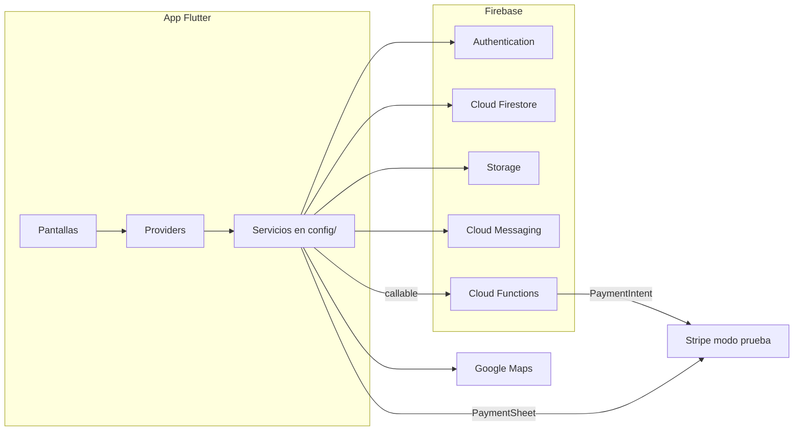

Las pantallas leen el estado de los providers (Provider), y las clases de `config/` se comunican con Firebase. Solo el pago pasa por una Cloud Function, que crea el PaymentIntent con la clave secreta de Stripe.

## Tecnologías

| Tecnología | Uso |
| --- | --- |
| Flutter / Dart | Aplicación móvil (Android e iOS) |
| Provider | Manejo de estado (sin `setState` ni `ValueNotifier`) |
| Firebase Authentication | Correo y contraseña, Google y GitHub |
| Cloud Firestore | Sedes, canchas, reservas, planes, suscripciones y usuarios en tiempo real |
| Firebase Storage | Fotos de perfil y de sedes |
| Firebase Cloud Messaging | Avisos por temas en primer plano, segundo plano y app cerrada |
| Cloud Functions (Node.js 22) | Creación del cobro en Stripe |
| Stripe (`flutter_stripe`) | Pago de membresías con PaymentSheet |
| `local_auth` | Huella digital para confirmar pagos y reservas |
| Google Maps (`google_maps_flutter`, `geolocator`) | Mapa nativo de sedes y ubicación del usuario |
| `cached_network_image` | Caché de imágenes para verlas sin internet |
| `google_fonts`, `shared_preferences` | Fuente Plus Jakarta Sans, tema y onboarding guardados |

## Funciones

- **Onboarding** de tres pantallas que solo aparece la primera vez.
- **Autenticación:** registro con correo y verificación obligatoria, reenvío del correo, recuperación de contraseña, Google y GitHub.
- **Perfil:** nombre, correo, método de acceso y avatar del proveedor. Solo las cuentas de correo pueden cambiar la foto (cámara o galería), que se sube a Storage y se sincroniza con el menú del dashboard.
- **Sedes y canchas** con fotos en caché, tipo de cancha y tarifa por hora.
- **Reservas** por día y hora con huella. Los horarios ocupados se actualizan en tiempo real y una transacción de Firestore impide empalmes. "Mis reservas" permite cancelar.
- **Membresías:** Básica, Premium y VIP pagadas con Stripe en modo de prueba, confirmadas con huella.
- **Avisos:** notificaciones desde la consola de Firebase a temas por sede, por nivel y combinados; listener global en todas las pantallas.
- **Mapa** con los marcadores de las sedes y la ubicación del usuario.
- **Tema claro y oscuro** y **diseño responsivo** (1, 2 o 3 columnas según el ancho).
- **Widget no visto en clase:** `DraggableScrollableSheet` en el detalle de la cancha.

## Colecciones de Firestore

| Colección | Campos |
| --- | --- |
| `usuarios/{uid}` | nombre, email, planId, topics |
| `sedes/{sedeId}` | nombre, direccion, lat, lng, fotoUrl, horarioApertura, horarioCierre, topic |
| `canchas/{canchaId}` | sedeId, nombre, tipo, tarifaHora |
| `reservas/{canchaId_fecha_hora}` | canchaId, canchaNombre, sedeId, sedeNombre, uid, fecha, horaInicio, horaFin, monto, estado, creadaEn |
| `planes/{planId}` | nombre, precio, beneficios |
| `suscripciones/{id}` | uid, planId, monto, estado, stripePaymentIntentId, fecha |

## Cloud Functions

| Función | Tipo | Descripción |
| --- | --- | --- |
| `crearPagoMembresia` | Callable | Valida la sesión, lee el precio del plan en Firestore y crea el PaymentIntent en Stripe |
| `cargarDatosPrueba` | HTTP | Carga los planes, sedes y canchas de prueba con las fotos de Storage |

## Temas de notificaciones

| Tema | Destinatarios |
| --- | --- |
| `general` | Todos los usuarios |
| `sede_torreslanda`, `sede_campestre` | Usuarios que siguen esa sede |
| `nivel_principiante`, `nivel_intermedio`, `nivel_avanzado` | Usuarios de ese nivel |
| `torreslanda_avanzado`, `campestre_intermedio`, etc. | Usuarios de esa sede y ese nivel |

## Estructura

```
lib/
├── main.dart
├── components/   tema, botones, avatar, tarjetas, fotos en caché, fechas
├── config/       email_auth, social_auth, firestore_*, storage_fotos, pagos, huella, notificaciones
├── models/       sede, cancha, reserva, plan
├── providers/    theme, login, usuario, pago, reserva, topics
└── screens/      onboarding, login, sign_in, verificar_correo, recuperar, dashboard, perfil,
                  sede, cancha_detalle, mis_reservas, membresias, pago, pago_exitoso, avisos, map
functions/        Cloud Functions (Node.js)
firestore.rules   reglas de Firestore
storage.rules     reglas de Storage
```

## Instalación local

Requisitos: Flutter 3.47 o superior, Android Studio con un emulador con Google Play, Node.js 22, Firebase CLI y FlutterFire CLI.

```bash
git clone https://github.com/EmilioRob2228/padel_club_moviles.git
cd padel_club_moviles
flutter pub get
flutterfire configure --project=<tu-proyecto> --platforms=android,ios
cp .env.example .env
```

1. Llena `.env` y agrega la API key de Maps a `android/local.properties` (ver variables abajo).
2. En la consola de Firebase: habilita Email/Password, Google y GitHub en Authentication; crea Firestore y Storage (el proyecto debe estar en plan Blaze).
3. Registra el SHA-1 de depuración de Android en la configuración del proyecto.
4. Sube funciones y reglas, y guarda la clave secreta de Stripe:
   ```bash
   cd functions && npm install && cd ..
   firebase functions:secrets:set STRIPE_SECRET_KEY
   firebase deploy --only functions,firestore:rules,storage
   ```
5. Sube `sedes/torreslanda.jpg` y `sedes/campestre.jpg` a Storage y abre la URL de `cargarDatosPrueba`.
6. Ejecuta la app:
   ```bash
   flutter run
   ```

Tarjeta de prueba de Stripe: `4242 4242 4242 4242`, cualquier fecha futura y cualquier CVC.

## Variables de entorno

| Variable | Dónde va | Descripción |
| --- | --- | --- |
| `STRIPE_PUBLISHABLE_KEY` | `.env` | Clave publicable de Stripe (`pk_test_...`) |
| `MAPS_API_KEY` | `android/local.properties` | API key de Maps SDK for Android |
| `STRIPE_SECRET_KEY` | Secret Manager (`firebase functions:secrets:set`) | Clave secreta de Stripe, solo en la Cloud Function |

Ninguno de estos valores, ni `google-services.json`, `GoogleService-Info.plist` y `firebase_options.dart`, se sube al repositorio.

## Capturas

| | | | |
| --- | --- | --- | --- |
| 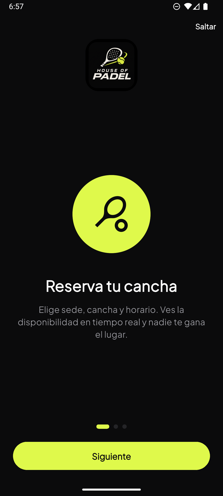 | 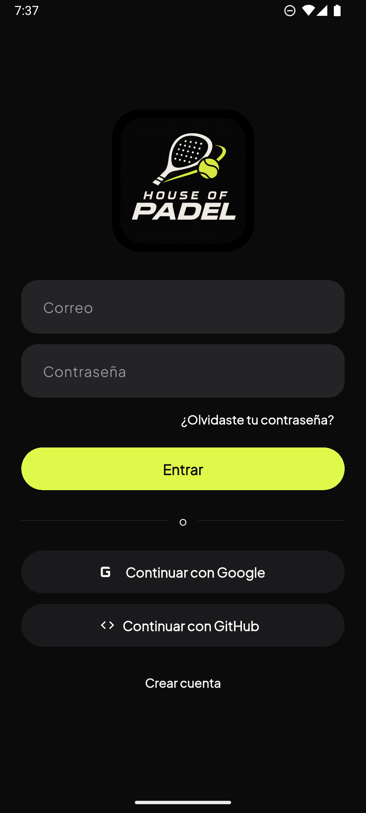 | 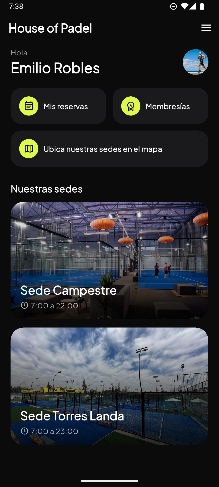 | 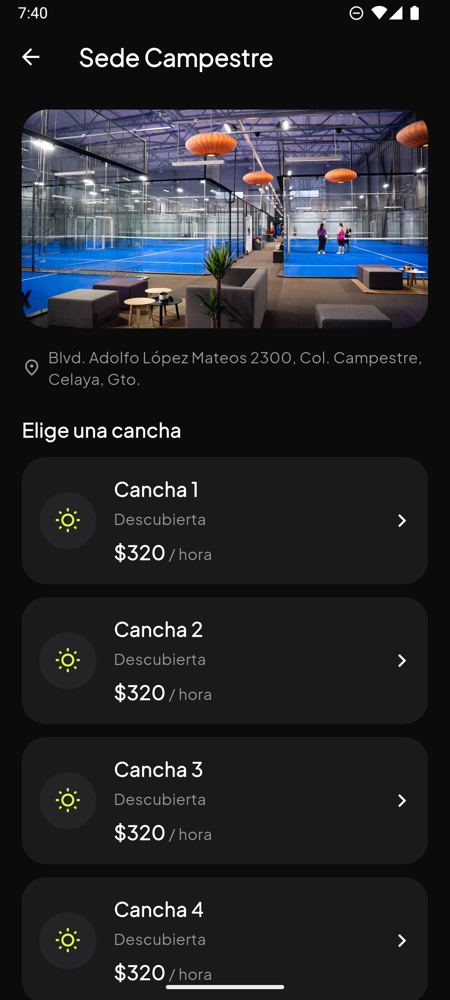 |
| 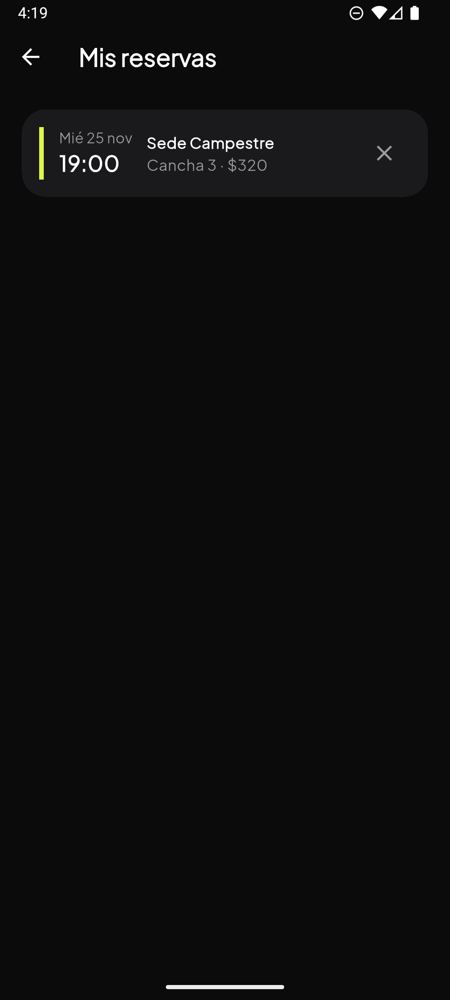 | 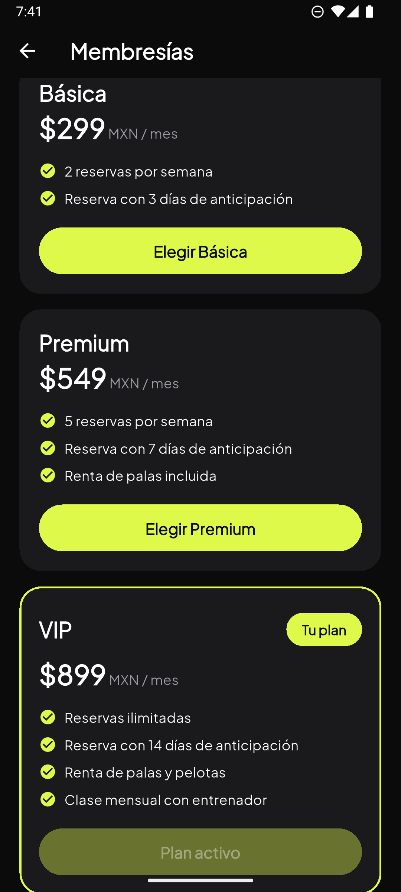 | 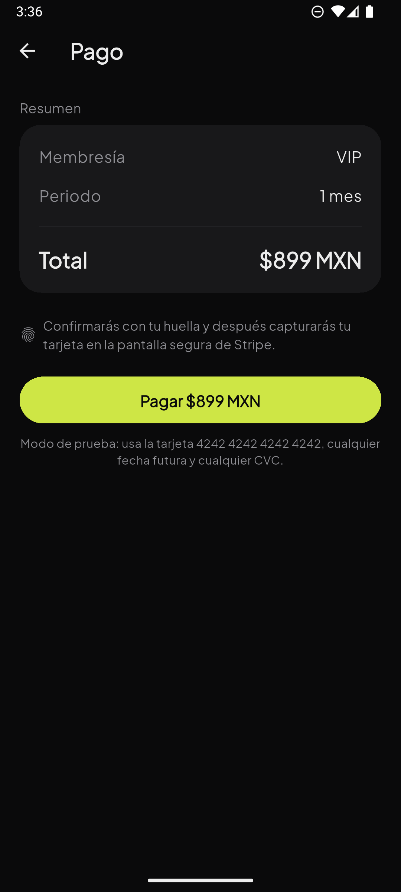 | 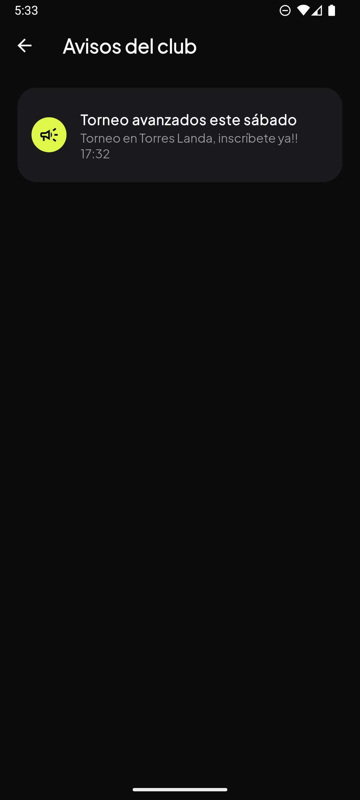 |
| 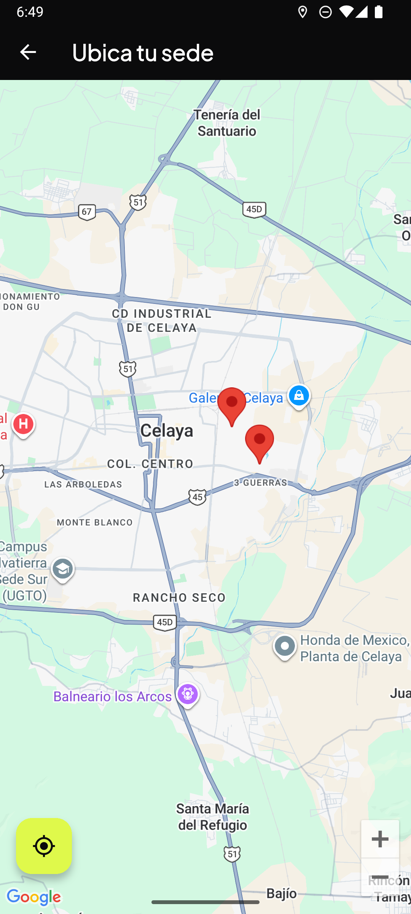 | 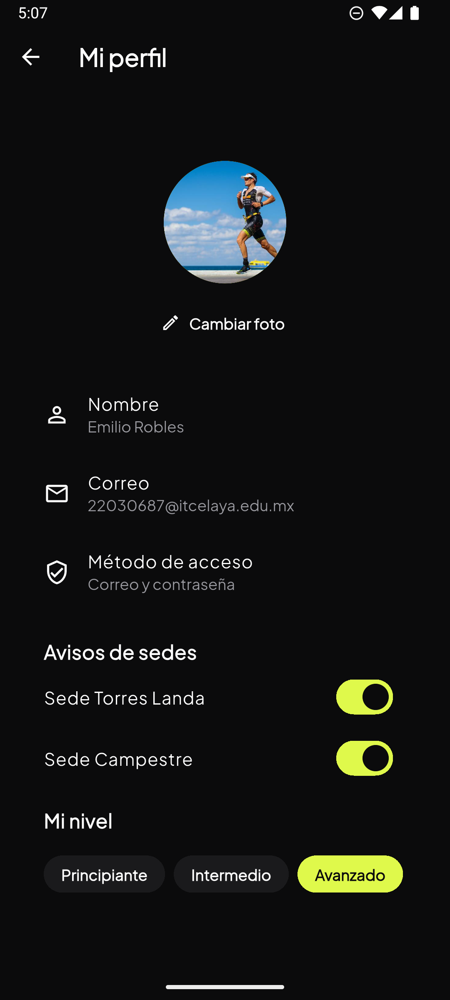 | | |

## Autor

Emilio Andrés Gómez Robles · [EmilioRob2228](https://github.com/EmilioRob2228)
